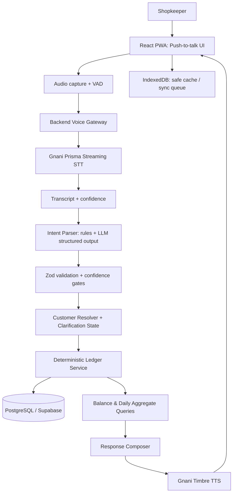

# Architecture — KhataAI

## 1. Finalized product decisions
- Language: Hindi + Hinglish first; keep locale/provider adapters extensible.
- Platform: responsive web application plus installable PWA, sharing one React codebase across desktop, tablet and Android mobile.
- Storage: Supabase PostgreSQL is the cloud source of truth; encrypted IndexedDB is the local cache and optional offline outbox.

## 2. Architecture principles
1. Speech AI understands audio; deterministic application code controls money.
2. The ledger is the source of truth.
3. No LLM can write directly to the database.
4. Provider integrations are replaceable adapters.
5. Uncertain inputs are clarified, never guessed into financial transactions.
6. Every committed change is auditable and idempotent.

## 3. High-level architecture



## 4. Runtime transaction pipeline
1. User holds push-to-talk.
2. Browser requests microphone access and captures mono audio.
3. Audio is streamed to a backend gateway; browser never receives provider secrets.
4. STT returns partial/final transcript.
5. Parser creates a strict intent object.
6. Validate schema, amount, direction, date, and confidence.
7. Resolve customer against shop-scoped customer records.
8. If ambiguous, ask a short spoken clarification and preserve pending state.
9. Ledger service validates and writes an append-only transaction using an idempotency key.
10. Query service computes the balance.
11. Response composer creates a short localized sentence.
12. TTS streams audio back; UI displays transcript, result, and sync state.

## 5. Suggested project structure

```text
src/
  app/
    routes/
    providers/
    store/
  components/
    voice/
    dashboard/
    customers/
    ledger/
    common/
  features/
    voice-session/
    transaction/
    customer/
    reports/
  lib/
    money/
    dates/
    validation/
    offline/
  services/
    speech/
      SpeechProvider.ts
      GnaniSpeechProvider.ts
      MockSpeechProvider.ts
    parser/
      IntentParser.ts
      RuleBasedParser.ts
      LLMIntentParser.ts
    ledger/
      LedgerService.ts
      BalanceService.ts
      CorrectionService.ts
    customer/
      CustomerResolver.ts
  types/
  tests/
server/
  routes/
  services/
  providers/
  middleware/
supabase/
  migrations/
  seed.sql
public/
  manifest.webmanifest
```

Adapt to the existing repository; do not force this exact layout if a sensible structure already exists.

## 6. Core data model
### shops
- id UUID PK
- name
- timezone default `Asia/Kolkata`
- default_language
- created_at

### users
- id UUID PK (auth provider ID)
- shop_id FK
- role (`OWNER`, `STAFF`)
- created_at

### customers
- id UUID PK
- shop_id FK
- display_name
- normalized_name
- phone_encrypted nullable
- created_at
- archived_at nullable

### ledger_transactions
- id UUID PK
- shop_id FK
- customer_id FK
- type (`CREDIT`, `PAYMENT`, `REVERSAL`, `ADJUSTMENT`)
- amount_paise BIGINT CHECK > 0
- effective_date DATE
- created_at TIMESTAMPTZ
- note nullable
- source (`VOICE`, `MANUAL`, `CORRECTION`)
- idempotency_key UNIQUE per shop
- reverses_transaction_id nullable FK
- created_by
- status (`POSTED`, `VOIDED` only if audit-safe policy permits)
- transcript_ref nullable (avoid storing transcript by default)

### pending_voice_sessions
- id UUID PK
- shop_id
- user_id
- state JSONB (short-lived)
- expires_at
- created_at

### audit_events
- id UUID PK
- shop_id
- actor_id
- entity_type
- entity_id
- action
- metadata JSONB (no secrets or raw transcript)
- created_at

## 7. Balance logic
For a customer:
`balance_paise = SUM(CREDIT.amount_paise) - SUM(PAYMENT.amount_paise) + SUM(ADJUSTMENT.signed_amount_paise)` with reversal entries represented explicitly and consistently. Choose one reversal convention and document/test it. Do not mix positive/negative semantics without a single canonical rule.

Use BIGINT/integer paise. Format only at display/speech boundary. Add reconciliation tests comparing cached balance (if used) with ledger-derived balance.

## 8. Intent parser contract
Use a discriminated union, not free-form JSON. Suggested fields:
- intent
- customer_name
- amount_paise
- effective_date
- confidence
- transcript
- correction_target_id (only when uniquely known)
- clarification_reason

Parser output must be validated server-side. Reject unknown keys or malformed values. Parser cannot issue database operations.

## 9. Speech integration
Define:
```ts
interface SpeechProvider {
  streamTranscription(input: {
    audio: ReadableStream<Uint8Array>;
    language: string;
    onPartial: (text: string) => void;
  }): Promise<{ text: string; language: string }>;

  synthesize(input: {
    text: string;
    language: string;
  }): Promise<ReadableStream<Uint8Array>>;
}
```
Use server-side Gnani adapter after verifying current official documentation, credentials, supported language codes, streaming transport, audio encoding, quotas, and commercial/demo terms. Keep a mock adapter for repeatable hackathon judging.

## 10. Security boundaries
- Browser -> own backend only.
- Backend -> Gnani/Gemini using server secrets.
- Supabase RLS: every row scoped to shop_id and authenticated membership.
- No service-role key in frontend.
- Avoid storing raw audio; ephemeral buffers only.
- Encrypt sensitive fields and backups at rest.
- Redact logs.
- Use rate limits and request-size limits.
- Use HTTPS/WSS.
- Validate MIME type, audio duration, and payload size.

## 11. Encrypted local cache and offline sync
### Data ownership
- Supabase PostgreSQL remains the authoritative shared ledger.
- IndexedDB is a local cache/outbox, not an independent competing source of truth.
- Cache only the minimum customer and ledger data needed for the active shop/session.
- Scope every local record by `shop_id`, user/session, schema version and cache expiry.

### Encryption design
- Use the browser Web Crypto API (AES-GCM) for authenticated encryption.
- Derive a key using PBKDF2 with a unique random salt and a strong user-entered PIN/passphrase, or use a reviewed secure session-key design. Do not store the raw key or passphrase in IndexedDB/localStorage.
- Store ciphertext, IV, salt, KDF parameters, version and non-sensitive metadata only.
- Apply inactivity lock and clear decrypted in-memory data on logout/lock.
- Explain that client-side encryption protects locally stored cache but does not replace TLS, Supabase RLS, server-side access control or device security.
- A short numeric PIN alone may be weak; enforce rate limiting/backoff where possible and recommend a stronger passphrase for sensitive deployments.
- Do not claim encryption is secure until key derivation, lock/logout, recovery, browser storage and threat-model tests are complete.

### Offline outbox
- Cache the app shell for offline launch.
- Queue only transactions that the shopkeeper explicitly confirmed.
- Each queued operation gets a UUID idempotency key and a visible `PENDING_SYNC` state.
- Keep original intent, amount in paise, customer ID and effective date encrypted.
- On reconnect, authenticate again, validate shop membership, submit idempotently, and mark `SYNCED` only after server acknowledgement.
- Handle deleted/changed customers and conflicting corrections with a user-visible resolution flow; never silently overwrite.
- If encryption or sync correctness is not implemented, allow read-only cached browsing (if encrypted) and disable offline financial writes.
- Show last successful sync time and pending item count.

## 12. Latency budget
Measure:
- audio end detection
- final transcript
- intent parse
- customer resolution
- database query/write
- TTS first byte

The <=2 second spoken-answer target is an end-to-end target, not a guarantee from any individual provider. Optimize short responses, stream TTS, reuse connections where supported, and measure on the actual demo network/device.

## 13. Gnani services in README
Document the exact service/version and transport actually used:
- STT: Gnani Prisma streaming (or REST fallback if streaming access unavailable).
- TTS: Gnani Timbre streaming/REST, if enabled.
- Include endpoint references, language codes, audio format, and tested date.
- Clearly label any mock provider.
