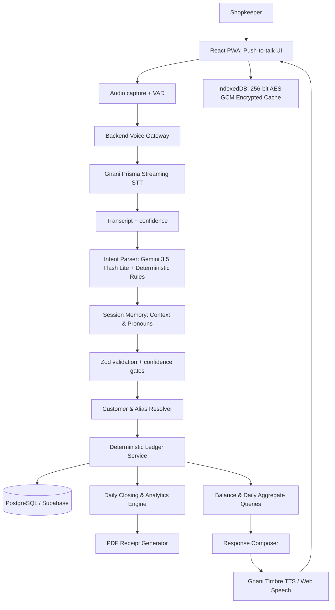

# Architecture — KhataAI (Advanced Edition)

## 1. Finalized product decisions
- Language: Hindi + Hinglish first; keep locale/provider adapters extensible.
- Platform: responsive web application plus installable PWA, sharing one React codebase across desktop, tablet and Android mobile.
- Storage: Supabase PostgreSQL is the cloud source of truth; encrypted IndexedDB is the local cache and optional offline outbox.
- Fixed Desktop Sidebar: Left navigation is fixed and independent; only central content area scrolls.

## 2. Architecture principles
1. Speech AI understands audio; deterministic application code controls money.
2. The ledger is the immutable append-only source of truth.
3. No LLM can write directly to the database or compute balances.
4. Provider integrations are replaceable adapters (Gnani Prisma, Gemini 3.5 Flash Lite, Web Speech API).
5. Uncertain inputs are clarified, never guessed into financial transactions.
6. Every committed change is auditable and idempotent.
7. Advanced features (Inventory, Reminders) are modular and decoupled.

## 3. High-level architecture



## 4. Runtime transaction pipeline
1. User holds push-to-talk.
2. Browser captures mono 16kHz audio stream.
3. Audio is proxied via backend voice gateway (`/api/voice/*`); client never receives provider secrets.
4. STT returns partial/final transcript.
5. Parser uses Gemini 3.5 Flash Lite structured JSON with deterministic fallback.
6. Session memory resolves relative pronouns ("usne", "inhe", "unka") and pending transaction context.
7. Customer resolver matches `display_name`, `normalized_name`, or shop-specific `aliases`.
8. If unknown, triggers Voice Customer Creation confirmation.
9. Ledger service performs append-only write with a unique idempotency key.
10. Query service computes running balance deterministically.
11. Localized spoken response generated and spoken back to shopkeeper.

## 5. Core data model

### shops
- id UUID PK
- name TEXT NOT NULL
- owner_name TEXT
- timezone TEXT NOT NULL DEFAULT 'Asia/Kolkata'
- default_language TEXT NOT NULL DEFAULT 'hi'
- created_at TIMESTAMPTZ NOT NULL DEFAULT now()

### profiles (auth users)
- id UUID PRIMARY KEY REFERENCES auth.users(id)
- shop_id UUID NOT NULL REFERENCES public.shops(id)
- role TEXT NOT NULL DEFAULT 'OWNER' CHECK (role IN ('OWNER', 'STAFF'))
- full_name TEXT NOT NULL
- phone TEXT
- created_at TIMESTAMPTZ NOT NULL DEFAULT now()

### customers
- id UUID PRIMARY KEY DEFAULT gen_random_uuid()
- shop_id UUID NOT NULL REFERENCES public.shops(id)
- display_name TEXT NOT NULL
- normalized_name TEXT NOT NULL
- aliases TEXT[] DEFAULT '{}' -- Shop-specific nicknames / titles
- phone_encrypted TEXT
- notes TEXT
- created_at TIMESTAMPTZ NOT NULL DEFAULT now()
- archived_at TIMESTAMPTZ

### ledger_transactions (Append-Only Deterministic Ledger)
- id UUID PRIMARY KEY DEFAULT gen_random_uuid()
- shop_id UUID NOT NULL REFERENCES public.shops(id)
- customer_id UUID NOT NULL REFERENCES public.customers(id)
- type TEXT NOT NULL CHECK (type IN ('CREDIT', 'PAYMENT', 'REVERSAL', 'ADJUSTMENT'))
- amount_paise BIGINT NOT NULL CHECK (amount_paise > 0)
- effective_date DATE NOT NULL
- created_at TIMESTAMPTZ NOT NULL DEFAULT now()
- note TEXT
- source TEXT NOT NULL CHECK (source IN ('VOICE', 'MANUAL', 'CORRECTION'))
- idempotency_key TEXT NOT NULL
- reverses_transaction_id UUID REFERENCES public.ledger_transactions(id)
- created_by UUID REFERENCES public.profiles(id)
- status TEXT NOT NULL DEFAULT 'POSTED' CHECK (status IN ('POSTED', 'VOIDED', 'PENDING_SYNC'))
- transcript_ref TEXT
- CONSTRAINT uq_shop_idempotency UNIQUE (shop_id, idempotency_key)

### inventory_items (Optional Modular Inventory)
- id UUID PRIMARY KEY DEFAULT gen_random_uuid()
- shop_id UUID NOT NULL REFERENCES public.shops(id)
- item_name TEXT NOT NULL
- normalized_name TEXT NOT NULL
- quantity_in_stock NUMERIC(10, 2) NOT NULL DEFAULT 0
- unit TEXT NOT NULL DEFAULT 'packet' -- 'packet', 'kg', 'litre', 'piece'
- price_paise BIGINT NOT NULL DEFAULT 0
- min_stock_threshold NUMERIC(10, 2) DEFAULT 5
- updated_at TIMESTAMPTZ NOT NULL DEFAULT now()

### audit_events
- id UUID PRIMARY KEY DEFAULT gen_random_uuid()
- shop_id UUID NOT NULL REFERENCES public.shops(id)
- actor_id UUID
- entity_type TEXT NOT NULL CHECK (entity_type IN ('CUSTOMER', 'TRANSACTION', 'SHOP', 'AUTH', 'INVENTORY'))
- entity_id UUID NOT NULL
- action TEXT NOT NULL CHECK (action IN ('CREATE', 'UPDATE', 'REVERSE', 'ARCHIVE', 'LOGIN', 'SYNC'))
- metadata JSONB
- created_at TIMESTAMPTZ NOT NULL DEFAULT now()

---

## 6. Context-Aware Voice Session Memory (Feature 1)
- **Short-Lived Ephemeral State**: Retained in-memory with a 90-second sliding expiration window.
- **State Schema**:
  ```ts
  interface VoiceSessionMemory {
    activeCustomerId: string | null;
    activeCustomerName: string | null;
    lastTransactionId: string | null;
    lastAmountPaise: number | null;
    lastIntent: VoiceIntent | null;
    timestamp: number;
  }
  ```
- **Anaphora Resolution**: Pronoun phrases (`usne`, `inka`, `unka`, `inhe`, `he`, `she`, `same customer`) are mapped directly to `activeCustomerId`.
- **Contextual Corrections**: Phrases like *"Nahi, 430"* without a customer name automatically bind to the active pending transaction.

## 7. Personalized Customer Aliases (Feature 2)
- Kirana shopkeepers frequently refer to customers using honorifics, relations, or nicknames (`Sharma ji`, `Master ji`, `Chintu ke papa`, `Nukkad wale Uncle`).
- Each customer can have multiple aliases (`aliases: string[]`).
- `CustomerResolver` performs multi-tier matching:
  1. Exact normalized name match.
  2. Exact alias match.
  3. Phonetic / Fuzzy Levenshtein match across both display names and aliases.
  4. Disambiguation trigger if an alias matches multiple customers.

## 8. Voice-Based Customer Creation (Feature 3)
- When speech references an unknown customer name, the system activates the `CONFIRM_NEW_CUSTOMER` state.
- Assistant speaks: *"Manoj Kumar naye grahak hain. Kya naya khata banayein?"*
- Shopkeeper confirms via voice ("Haan / Banado") or 1-click UI confirmation button.
- Atomically creates the customer record and executes the pending credit/payment in a single deterministic flow.

## 9. Daily Closing Reports Engine (Feature 4)
- **Voice Trigger**: *"Aaj ka hisaab dikhao"* / *"Daily closing report"*.
- **Metrics Calculated Deterministically**:
  - `total_credit_paise` (Total credit extended today)
  - `total_payment_paise` (Total cash recovery collected today)
  - `net_change_paise` (`credit - payment`)
  - `active_customers_count` (Distinct customers with transactions today)
  - `top_debtors_today` (Customers who took the largest credit today)
- Formatted summary rendered in UI and read aloud via TTS.

## 10. AI-Powered Business Analytics (Feature 5)
- **Deterministic Separation**: Gemini classifies speech queries into analytical intents (`ANALYTICS_AGING`, `ANALYTICS_TOP_DEBTORS`, `ANALYTICS_RECOVERY_RATE`, `ANALYTICS_COLLECTION_SUMMARY`).
- The actual calculations are performed by deterministic TypeScript functions querying IndexedDB/Supabase.
- **Aging Analysis Buckets**:
  - 0-7 Days (Recent credit)
  - 8-15 Days (Due for follow-up)
  - 16-30 Days (Overdue)
  - 30+ Days (High credit risk)
- Recovery rate: `(total_payment_paise / total_credit_paise) * 100`.

## 11. PDF Transaction Receipt Generator (Feature 6)
- Instant generation of printable and shareable PDF transaction slips.
- Includes shop name, owner name, date, time, customer name, transaction type, amount in ₹, previous balance, updated balance, and unique transaction UUID.
- Client-side vector PDF generation using standard canvas/print stylesheets for offline reliability.

## 12. Auditable Transaction Undo / Reversals (Feature 7)
- Immediate 1-tap "Undo (वापस लें)" toast after any transaction.
- Spoken trigger: *"Pichhla transaction undo karo"*.
- Strictly append-only: Creates an explicit `REVERSAL` transaction referencing `reverses_transaction_id`.
- Reversing a credit subtracts the balance; reversing a payment restores the balance.
- Full audit event logged with timestamp and reason.

## 13. Modular Voice Inventory Management (Feature 8)
- Optional module toggled in Settings (`enableInventoryModule: boolean`, default off).
- When enabled, introduces an inventory tab and voice intents (`QUERY_INVENTORY`, `UPDATE_STOCK`).
- Queries current stock, updates restock amounts, and highlights low-stock alerts.
