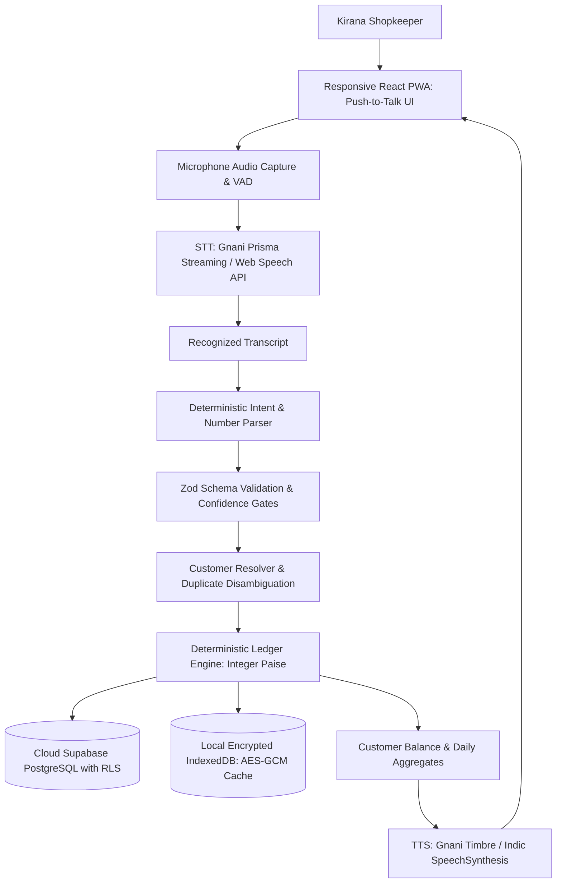

# KhataAI — Voice-Powered Digital Khata for Kirana Stores

> **Bolo. Likho. Hisaab Jaano.**  
> *BOL Bharat Hackathon PS2 – Voice Khata for Kirana Stores*

KhataAI is a voice-first digital ledger specifically engineered for Indian kirana store owners. In the rush hour of a busy counter, typing is impractical and error-prone. KhataAI allows shopkeepers to press and hold a large microphone button, speak naturally in Hindi or Hinglish, receive spoken confirmations, and keep a 100% mathematically accurate digital khata book.

---

## 🌟 Key Highlights & Design Decisions

- **Deterministic Financial Invariants**: Money is stored and calculated strictly as integer paise (`BIGINT`). Zero floating point rounding errors. AI is used solely for speech understanding and intent classification—never for calculating balances or modifying financial records directly.
- **Append-Only Ledger**: Transactions are never silently mutated or deleted. Corrections create explicit, auditable reversal records (`REVERSAL` / `ADJUSTMENT`) linking back to the original entry.
- **Hindi + Hinglish Voice Intelligence**: Built-in deterministic number parsing for Indic numbering formats:
  - Digits: `340`, `200`, `1500`
  - Hindi number words: *teen sau chaalis* (340), *paanch sau* (500), *ek hazaar* (1000), *do hazaar paanch sau* (2500)
  - Fractional terms: *dedh sau* (150), *dhaai sau* (250), *dedh hazaar* (1500)
  - English phrases & shorthand: *three hundred forty* (340), *three-forty* (340), *two-fifty* (250)
- **Duplicate Customer Disambiguation**: When multiple customers share a name (e.g. *Ramesh Sharma* and *Ramesh Gupta*), the system immediately detects the ambiguity and asks: *"Is naam ke do customer hain. Ramesh Sharma ya Ramesh Gupta?"* No financial write occurs until clarified.
- **Pending Draft Corrections**: If the shopkeeper says *"Ramesh ka 340 udhaar"* and immediately follows up with *"Nahi, 430"*, the draft amount is updated to ₹430 and read back for confirmation.
- **Responsive Website + Installable PWA**: Works on desktop, laptop, tablet, and Android smartphones with full PWA installability, service worker precaching, and an offline app shell.
- **Security & Web Crypto AES-GCM**: Sensitive local cache data in IndexedDB is encrypted at rest using the browser's Web Crypto API (AES-256-GCM) with key derivation from a user-entered PIN via PBKDF2 (100,000 iterations, SHA-256).

---

## 🏗️ Architecture



---

## 🛠️ Tech Stack

- **Frontend**: React 19, TypeScript (strict mode), Vite
- **Styling**: Tailwind CSS v4 (Custom Indian Fintech Palette: Navy `#253B73`, Emerald `#087F6E`, Saffron `#E7A23B`, Ivory `#F8F7F2`)
- **PWA & Offline**: `vite-plugin-pwa`, Service Worker with Workbox precaching, App Manifest
- **Local Persistence & Encryption**: IndexedDB + Web Crypto API AES-GCM (256-bit)
- **Database & Auth**: Supabase PostgreSQL with Row Level Security (RLS)
- **Speech Recognition (STT)**: Gnani Prisma Streaming STT adapter + Web Speech API fallback
- **Text-to-Speech (TTS)**: Gnani Timbre TTS adapter + Indic SpeechSynthesis fallback
- **Validation & Testing**: Zod schemas, Vitest unit test suite

---

## 🚀 Quick Setup & Running Locally

### 1. Prerequisites
- Node.js 18+ (tested on Node v24.22.1)
- npm or pnpm

### 2. Clone and Install
```bash
git clone <repository-url>
cd "Khata AI"
npm install
```

### 3. Environment Variables
Copy `.env.example` to `.env`:
```bash
cp .env.example .env
```
Configure your settings:
```env
# Application Mode: 'demo' (instant evaluation mode) or 'production'
VITE_APP_MODE=demo

# Supabase Cloud Database (Anon key only - never service_role in frontend)
VITE_SUPABASE_URL=https://your-project-ref.supabase.co
VITE_SUPABASE_ANON_KEY=eyJhbGciOiJIUzI1NiIsInR5cCI6IkpXVCJ9...
```

### 4. Running the Development Server
```bash
npm run dev
```
Open your browser at `http://localhost:5173`.

### 5. Running Unit Tests
```bash
npm run test
```
All 26 financial and parser test suites run in ~2.3 seconds with 100% pass rate.

### 6. Building for Production
```bash
npm run build
npm run preview
```

---

## 📊 Database Schema & Row Level Security

The complete Supabase PostgreSQL schema and migration script is located at:
[`src/services/database/schema.sql`](file:///c:/Users/kd/OneDrive/Desktop/Khata%20AI/src/services/database/schema.sql)

### Tables:
1. `shops`: Store metadata, timezone (`Asia/Kolkata`), language (`hi`).
2. `profiles`: Authenticated users linked to `auth.users` with `OWNER` / `STAFF` roles.
3. `customers`: Customer records scoped to shop, with normalized search names.
4. `ledger_transactions`: Append-only records with integer paise `amount_paise`, idempotency constraint `(shop_id, idempotency_key)`, effective date, and audit references.
5. `audit_events`: Security and operational audit log.
6. `pending_voice_sessions`: Ephemeral state for active voice disambiguation.

### Row Level Security (RLS):
- Every table has RLS enabled.
- All policies strictly check `shop_id = public.get_auth_shop_id()`.
- Public read/write access is strictly forbidden.

---

## 🎙️ Demo Mode & Hackathon Acceptance Scenarios

KhataAI includes a fully operational Demo Mode pre-loaded with synthetic kirana customers:
- **Ramesh Sharma** (Regular buyer, Sector 4)
- **Ramesh Gupta** (Sweet shop owner, Sector 2)
- **Suresh Kumar** (Tailor shop next door)
- **Amit Verma** (Dairy supplier)
- **Priya Singh** (House No. 102)

### Required Test Scenarios:

| # | Spoken Command | Recognized Intent | Result / Ledger Action | Spoken Confirmation |
|---|----------------|-------------------|------------------------|---------------------|
| 1 | *"Ramesh ka 340 udhaar"* | `ADD_CREDIT` | Credit +₹340.00 added to Ramesh Sharma | *"Ramesh Sharma ke naam 340 rupaye udhaar darj ho gaya."* |
| 2 | *"Ramesh ne 200 diye"* | `RECORD_PAYMENT` | Payment -₹200.00 recorded | *"Ramesh Sharma se 200 rupaye payment darj ho gaya."* |
| 3 | *"Ramesh ka total kitna hai?"* | `QUERY_CUSTOMER_BALANCE` | Deterministic balance calculated | *"Ramesh Sharma ka total baaki ₹140 hai."* |
| 4 | *"Aaj kitna udhaar gaya?"* | `QUERY_DAILY_CREDIT` | Sum of today's credit entries | *"Aaj 1,240 rupaye ka udhaar gaya hai."* |
| 5 | *"Nahi, 430"* | `CORRECT_PENDING_TRANSACTION` | Draft updated from ₹340 to ₹430 | *"Theek hai, Ramesh ka 430 rupaye udhaar likh raha hoon."* |
| 6 | *"Ramesh ka 500 udhaar"* | `CLARIFY` / Disambiguation | Multiple candidates identified | *"Is naam ke 2 customer hain. Ramesh Sharma ya Ramesh Gupta?"* |
| 7 | *"Kal Ramesh ne 500 diye"* | `RECORD_PAYMENT` (Relative) | Effective date resolved to yesterday | *"Ramesh Sharma se 500 rupaye payment darj ho gaya."* |

---

## 🔒 Security, Privacy & Responsible AI

1. **AI Disclosure**: First-turn disclosure informs the user that KhataAI is an automated assistant.
2. **Audio Retention**: Audio buffers are ephemeral and discarded immediately after transcription. No voice cloning or raw audio storage.
3. **No Debt Pressure or Harassment**: In accordance with the BOL Bharat Hackathon guidelines, no predatory interest calculations, threatening language, or automated collection harassment are permitted. Reminders are polite and strictly opt-in.
4. **Key Management**: Client-side AES-GCM encryption keys are derived in volatile memory via PBKDF2 and cleared on session lock/logout. Raw secrets are never saved in local storage.

---

## 📱 PWA Installation Guide

- **Android Chrome**: Open the website, tap the **"Install App"** button in the top navigation or select **"Add to Home screen"** from Chrome settings.
- **Desktop Chrome / Edge**: Click the install icon in the URL bar to run KhataAI as a standalone desktop application.

---

## 👥 Authors
Built for the **BOL Bharat Hackathon – PS2: Voice Khata for Kirana Stores**.
